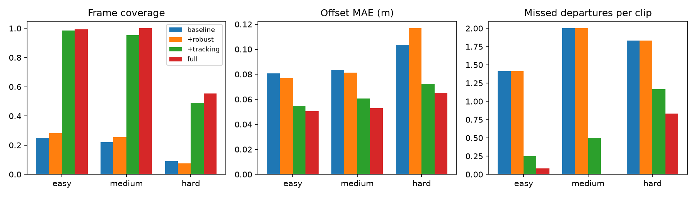

# Lane-drift monitor

Turns a dashcam video into **lateral position, lane-departure events and an annotated clip**, for driver-safety review (fleet telematics, drowsy-drift detection, post-trip coaching). Built for continuous video rather than single images: temporal consistency, lateral position in metres instead of pixels, and a measured alert policy.



## What it does

```
frame -> colour mask (yellow/white + local contrast) -> Canny -> lane-guided ROI -> Hough
      -> slope filter -> robust line fit -> tracker (gate, smooth, coast, single-line inference)
      -> lateral offset in metres -> hysteresis state machine -> departure events (JSON)
```

About 9.5 ms per 960x540 frame on one CPU core (about 100 FPS, detector only), no GPU, no learned weights.

## Results (held-out simulated clips, 12 per difficulty, 20 s each)

| difficulty | variant | frame coverage | offset MAE (m) | departure recall | precision |
| - | - | - | - | - | - |
| easy | per-frame baseline | 0.25 | 0.081 | 0.00 | n/a |
| easy | **full** | **0.99** | **0.051** | **0.94** | 1.00 |
| medium | per-frame baseline | 0.22 | 0.083 | 0.00 | n/a |
| medium | **full** | **1.00** | **0.053** | **1.00** | 0.96 |
| hard | per-frame baseline | 0.09 | 0.104 | 0.00 | n/a |
| hard | **full** | 0.55 | 0.065 | 0.55 | 1.00 |


Full tables with 95% bootstrap intervals: [`outputs/results/summary.md`](file:///run/media/danish/404/AK/projects/lane-drift-monitor/outputs/results/summary.md). Analysis, ablations and limitations: [`REPORT.md`](file:///run/media/danish/404/AK/projects/lane-drift-monitor/REPORT.md).

**Read this before trusting the numbers.** The evaluation video is *simulated* (exact ground truth, but not real footage). On 25 real photos the simulator-tuned detector found both lines less often than the baseline (60% vs 76%), and 3 of 12 hard (dim) clips fail completely. See REPORT.md, "Limitations".

## Quick start

```
pip install -r requirements.txt
python -m pytest -q tests
python -m lanedrift analyse my_drive.mp4 --out outputs/run1 --config configs/final.json --lane-width 3.7
# -> outputs/run1/{frames.csv, events.json, annotated.mp4}
uvicorn lanedrift.api:app            # POST /frame (image) -> lines + offset_m
```

Reproduce everything: `make all` (about 10 min tuning + 15 min evaluation on 8 cores), or run [`notebooks/run_on_colab.ipynb`](file:///run/media/danish/404/AK/projects/lane-drift-monitor/notebooks/run_on_colab.ipynb) on Colab (CPU is enough).

## Layout

```
lanedrift/   detect.py track.py geometry.py events.py pipeline.py simulate.py metrics.py runner.py video.py api.py config.py
scripts/     tune.py (validation seeds) run_eval.py (test seeds) make_report.py eval_real_stills.py
configs/     baseline.json final.json (tuned on validation clips only)
tests/       geometry, fitting, tracker, event logic, simulator, end-to-end
docs/        ARCHITECTURE.md METHOD.md DATASET.md
outputs/     results/ (CSV, summary.md), figures/, demo/demo_medium.mp4
```

## Engineering notes

- Every threshold lives in `Config`; tuned configs are JSON files under version control.

- Tuning uses validation seeds (1000+); evaluation uses seeds 0-299. Nothing is tuned on the test clips.

- Clip generation is seeded and deterministic; per-clip scores are stored so any table can be regenerated.

- Intervals resample clips (the unit of independence), not frames.

- Assumes a forward camera at a fixed mount; the metric scale comes from an assumed 3.7 m lane width.

