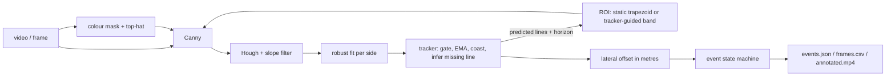

# Architecture

| Module | Responsibility |
|---|---|
| `config.py` | all parameters (dataclasses), `baseline_config()` = the plain per-frame pipeline, JSON load/save |
| `detect.py` | colour mask, ROI builders, Hough, slope filter, line fit |
| `track.py` | two-line tracker |
| `geometry.py` | pixels to metres |
| `events.py` | departure state machine |
| `pipeline.py` | `LaneMonitor.process(frame)` ties it together (guided ROI feedback loop) |
| `simulate.py` | ground-truth road renderer |
| `metrics.py`, `runner.py` | scoring and batch runs |
| `video.py`, `__main__.py`, `api.py` | video CLI, annotated output, FastAPI frame endpoint |

## Failure handling
No lines: coast, then report no offset (never a made-up one). Lines closer than 15% of frame width: treated as not a lane.
Low confidence frames cannot start or end an event. Undecodable upload: HTTP 400.

## Deployment notes
Detector cost is ~10 ms/frame/core, so edge devices and batch review are both fine. For real fleets, add per-vehicle camera
calibration (mount offset, lane-width prior by road class), a speed gate (no alerts at low speed or with the indicator on),
and review of every alert before it reaches a driver.
